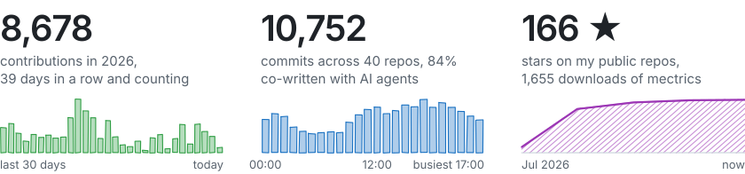

Most of my side projects start with data nobody had put on a map or a screen yet. I take it the whole way, from collecting it to the app you actually open, and lately I build with a crew of AI agents.

<picture>
  <source media="(prefers-color-scheme: dark)" srcset="./dist/stats-dark.svg" />
  
</picture>

**Things I made:** [mectrics](https://github.com/farukkamcici/mectrics), a small private system monitor for the Mac menu bar. [DoluMu](https://www.dolumu.app), how crowded your metro is right now. [Handlez](https://handlez.app), NBA numbers with a fantasy edge.

Say hi on [LinkedIn](https://linkedin.com/in/farukkamcici), at [farukkamcici.me](https://farukkamcici.me) or by [email](mailto:farukkamcici@gmail.com).
